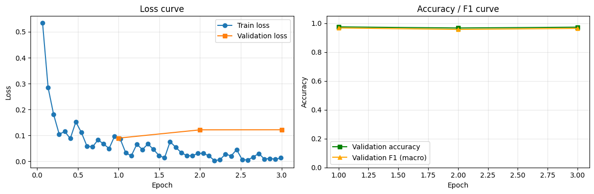
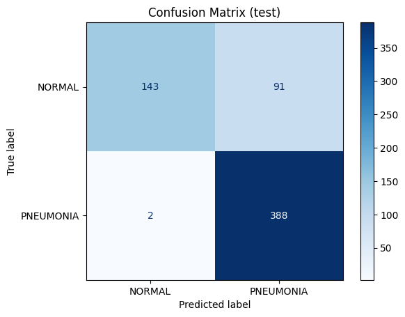
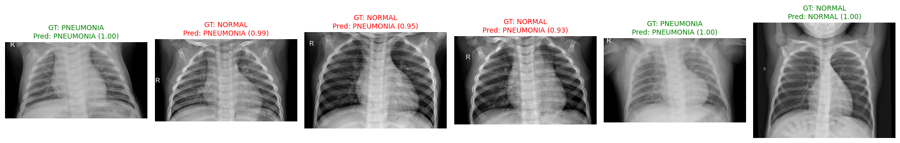
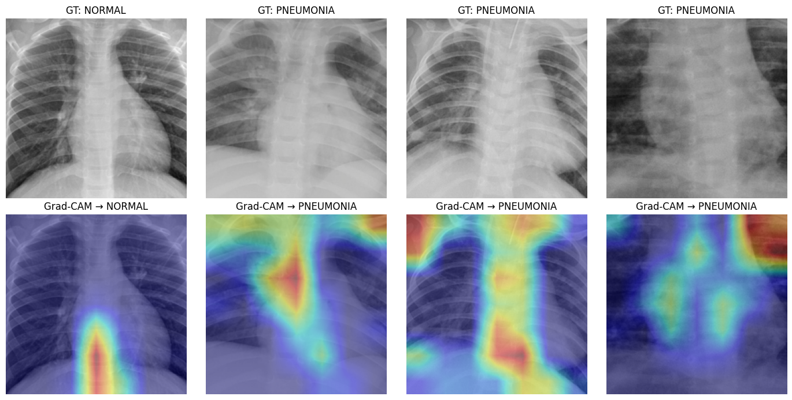

# Image Classification — Pneumonia Detection on Pediatric Chest X-rays

> **Week 3** · 비전 AI와 비즈니스 · Transfer learning with Hugging Face `Trainer` + Grad-CAM (XAI)

## TL;DR
- Fine-tuned **ConvNeXt-Tiny** (ImageNet-pretrained) to classify chest X-rays as **NORMAL / PNEUMONIA**.
- Test accuracy rose **0.367 → 0.851** and sensitivity hit **0.995** (2 missed pneumonia cases out of 390).
- But **Grad-CAM showed the model looking at the mediastinum, spine and image corners, not the lung fields** → suspected *shortcut learning*. High accuracy ≠ clinically trustworthy.

## Setup
| | |
|---|---|
| **Dataset** | [`hf-vision/chest-xray-pneumonia`](https://huggingface.co/datasets/hf-vision/chest-xray-pneumonia) — Kermany et al. (2018), pediatric AP chest X-rays (1–5 y), CC BY 4.0 |
| **Model** | [`facebook/convnext-tiny-224`](https://huggingface.co/facebook/convnext-tiny-224) — ConvNeXt-Tiny, 27.8M params, ImageNet-1k, Apache-2.0 |
| **Split** | Official val has only 16 images → 10% of train split off (stratified) train 4,694 · val 522 · test 624 (NORMAL 234 / PNEUMONIA 390) |
| **Training** | 3 epochs · batch 32 · lr 5e-5 · fp16 · best model by val F1 · ~5.8 min on T4 |

## Pipeline
1. Zero-shot `pipeline` inference → ImageNet labels (*"shower curtain"*, *"trilobite"*) — no medical meaning
2. Grayscale → RGB, resize & normalize with `AutoImageProcessor`
3. Replace classifier head 1000 → 2 classes (`ignore_mismatched_sizes=True`)
4. Fine-tune with `Trainer`
5. Evaluate with accuracy, macro-F1, **sensitivity, specificity**, confusion matrix
6. **Grad-CAM** on the last ConvNeXt stage to visualize decision evidence

## Results (test set, 624 images)
| Metric | Before (random head) | After fine-tuning |
|---|---|---|
| Accuracy | 0.367 | **0.851** |
| F1 (macro) | 0.295 | **0.824** |
| Sensitivity (pneumonia) | 0.038 | **0.995** |
| Specificity (normal) | 0.915 | **0.611** |

> Baseline note: predicting "PNEUMONIA" for every image already gives 0.625 accuracy, so F1 / sensitivity / specificity are reported alongside accuracy.

| Learning curve | Confusion matrix |
|---|---|
|  |  |

**Predictions** (green = correct, red = wrong)

**Grad-CAM**

## Findings
- **Overfitting after epoch 1** — val loss lowest at epoch 1 (0.090), rose to ~0.122 while train loss kept falling. The epoch-1 checkpoint was restored.
- **Val 0.975 vs test 0.851** — val comes from the same distribution as train; the official test set does not. In-distribution validation overestimates real performance.
- **Biased toward pneumonia** — 91 false positives (normal → pneumonia), several with 0.93–0.99 confidence. Likely driven by class imbalance (~74% pneumonia in train).
- **Shortcut learning suspected** — heatmaps concentrate on the mediastinum, spine and image corners instead of lung opacities (consolidation). The model may rely on brightness or acquisition cues rather than pathology.

## Business takeaway
As-is, this model should **not** be used for diagnosis. Its value lies in the **workflow**: XAI caught an untrustworthy model that metrics alone would have shipped. With lung-region cropping, multi-site external validation and radiologist review of heatmaps, it could serve as a **triage assistant** that prioritizes suspected pneumonia cases, with the physician making the final call.

## Next steps
- [ ] Lung segmentation → train on lung-only regions → check whether Grad-CAM moves into the lung fields (**Week 6**)
- [ ] Class-weighted loss / oversampling, data augmentation, threshold tuning
- [ ] External validation on adult / multi-site data

## Run it
Open [`image_classification_chest_xray_convnext.ipynb`](./image_classification_chest_xray_convnext.ipynb) in Colab → Runtime: **T4 GPU** → Run all.
Change `DATASET` / `CHECKPOINT` at the top to try other data or models.

## References
- Kermany, D. et al. (2018). *Identifying medical diagnoses and treatable diseases by image-based deep learning.* Cell 172(5).
- Liu, Z. et al. (2022). *A ConvNet for the 2020s.* arXiv:2201.03545.
- Selvaraju, R. R. et al. (2017). *Grad-CAM: Visual explanations from deep networks via gradient-based localization.* ICCV.
