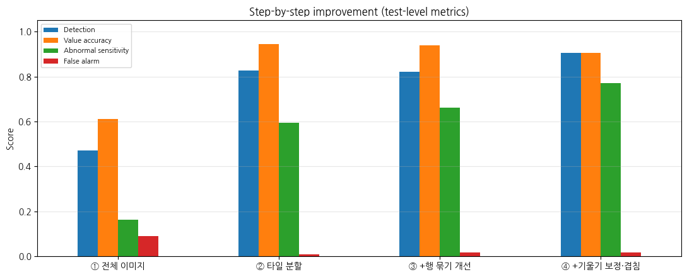
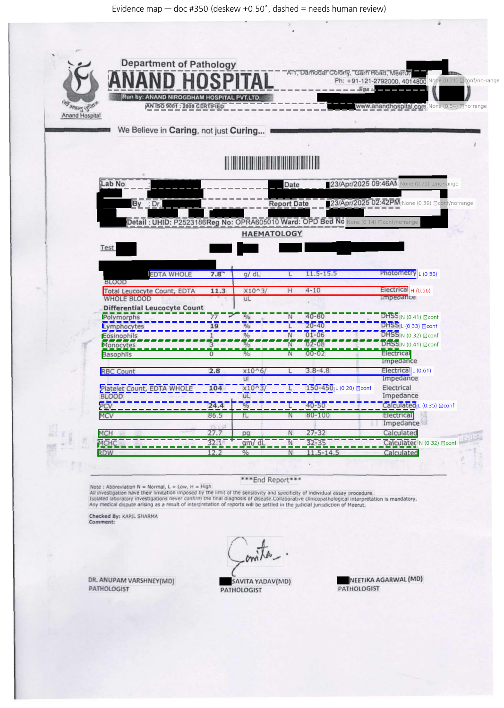
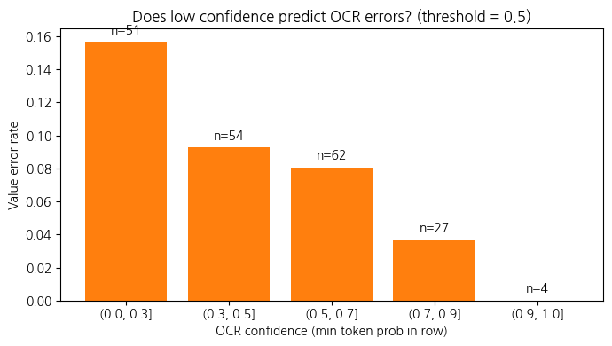
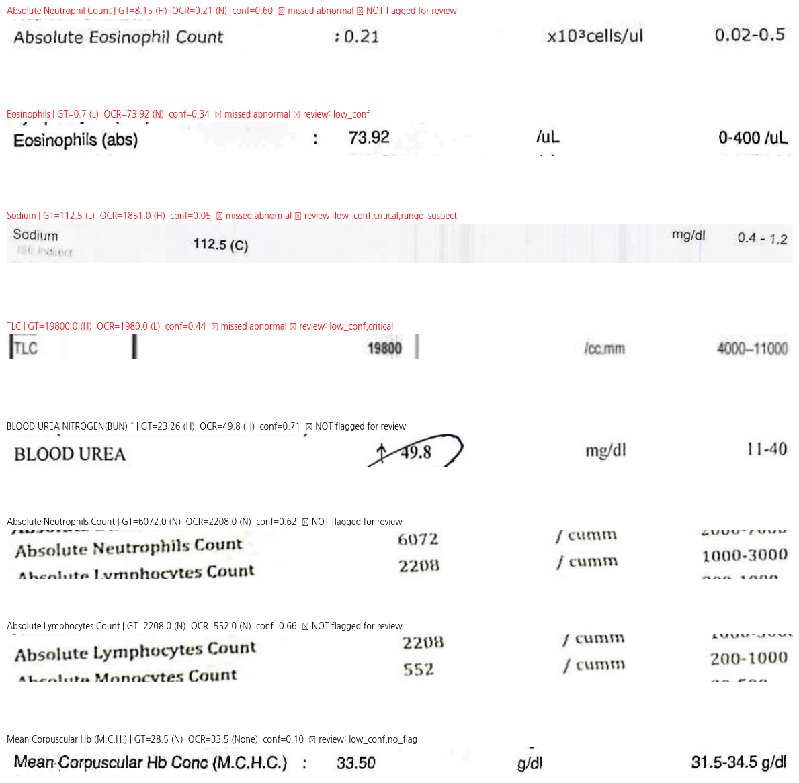

# OCR — Reading Lab Reports and Flagging Abnormal Values

> **Week 7** · 비전 AI와 비즈니스 · Zero-shot Florence-2 OCR + rule-based parsing + a human-review safety layer

## TL;DR
- Read **real hospital lab reports** (redacted Indian reports) with **Florence-2** (`<OCR_WITH_REGION>`: text + boxes), then extracted test name, value and reference range and flagged **H / L / N**.
- **No fine-tuning.** Preprocessing alone (tiling, row grouping, deskew) raised abnormal-value sensitivity from **0.16 to 0.77** and cut false alarms from 0.09 to 0.02.
- A **safety layer** sends uncertain rows to a human. It reviews **59%** of rows and catches **9 of 12 (75%)** dangerous errors.
- The errors it misses are **confident layout errors**: the characters were read correctly but attached to the **wrong test row**. Token confidence can't see these.

## Setup
| | |
|---|---|
| **Dataset** | [`naazimsnh02/medocr-vision-dataset`](https://huggingface.co/datasets/naazimsnh02/medocr-vision-dataset) (MIT) — lab-report subset. Validation + test pool → 90 lab reports → 28 with ≥ 3 flaggable tests → **20 evaluated (219 tests with a reference range)** |
| **Ground truth** | Extracted from the images by an LLM (stated in the dataset card), so "accuracy" = agreement with another model. Disagreements were checked against the original images. |
| **Model** | [`florence-community/Florence-2-base`](https://huggingface.co/florence-community/Florence-2-base) — native `transformers` port, no `trust_remote_code` |

## Pipeline
1. **Filter** lab reports from a mixed dataset (prescriptions, receipts, invoices).
2. **Parse the ground truth**: one-line markdown tables split into rows, `28,900` → 28900, `:8.9` → 8.9, sex-specific ranges (`M:13-18 F:11.5-16.5`) chosen by patient sex — **unknown sex → no flag** rather than a guessed range.
3. **OCR**: deskew the scan, split it into overlapping **tiles** (Florence-2 downsizes inputs to 768×768, which blurs small digits on an A4 page), run `<OCR_WITH_REGION>`, merge and de-duplicate boxes.
4. **Rows → tests**: group boxes by height, merge two-line test names, parse value + range, assign **H / L / N**.
5. **Safety layer** — each row goes to human review if any rule fires:

| Rule | Fires when |
|---|---|
| `low_conf` | Minimum token probability in the row < 0.5 |
| `critical` | Value < ½ × lower limit or > 2 × upper limit (true critical value *or* a digit error) |
| `no_flag` | Value read, but no reference range → can't judge |
| `range_suspect` | Parsed range is far (> 3×) from the test's **typical adult range** in any unit — e.g. Sodium with 0.4–1.2 (a creatinine range from another row) |
| `printed_mismatch` | Report's own printed H / L / ↑↓ disagrees with the computed flag |

6. **Evaluate** against the ground truth with clinically aware matching (RBC ≠ WBC, neutrophil ≠ eosinophil, % ≠ absolute count, MCH ≠ MCHC).

## Results (20 reports, 219 tests)
| Metric | Baseline: full page, 1 pass | Final pipeline |
|---|---|---|
| Test detection | 0.470 | **0.904** |
| Value accuracy (of detected) | 0.612 | **0.904** |
| Abnormal (H/L) sensitivity | 0.162 | **0.770** |
| False alarm (N → H/L) | 0.091 | **0.016** |
| Can't judge (range not read) | 0.534 | **0.116** |
| Human review rate | 0.990 | **0.591** |
| Dangerous errors / caught by review | 25 / 25 | 12 / **9 (75%)** |
| Time (20 reports, T4) | 129 s | 275 s |

> The baseline "catches" 100% only because 99% of its rows have low confidence and go to review, so there's no automation.

**Flag confusion matrix (final)**
| GT \ OCR | H | L | N | no flag | not found |
|---|---|---|---|---|---|
| H (30) | **23** | 2 | 3 | 0 | 2 |
| L (44) | 3 | **34** | 1 | 3 | 3 |
| N (145) | 1 | 1 | **107** | 20 | 16 |

**What each safety rule caught (198 detected rows)**
| Rule | Sent to review | Value errors in it | Dangerous errors in it |
|---|---|---|---|
| low_conf | 105 | 13 | 6 |
| critical | 12 | 6 | 4 |
| no_flag | 23 | 4 | 3 |
| range_suspect | 3 | 1 | 2 |
| printed_mismatch | 0 | 0 | 0 |
| **Any** | **117 (59%)** | **15 / 19** | **9 / 12** |

### Evidence map (XAI)
Every flag is traced back to a box on the original page. Red = H, blue = L, green = N, dashed = sent to human review.
On this report the computed H/L flags match the lab's own printed H/L column. The extracted values are also clinically coherent: normocytic anemia + thrombocytopenia + mild leukocytosis.

### Does confidence predict errors?

Low confidence predicts **reading** errors (digit misreads such as TLC 19,800 → 1,980), but not **alignment** errors.

### Error gallery (manual verification)

## Findings
- **Preprocessing matters more than the model here.** Keeping resolution through tiling was the single biggest gain.
- **Token confidence ≠ correctness.** The 3 dangerous errors that escaped review had confidence 0.60–0.74. OCR read the characters correctly, but a value or range from a **neighbouring row** was attached to the test.
- **Medical knowledge works as a safety rule.** `range_suspect` checks whether a parsed range *looks like* that test's range. It fired only 3 times, and 2 were dangerous errors.
- **The sickest patient's report was the hardest to read.** One severe renal-failure report (urea 104, creatinine 8.51, Na 112.5) caused 7 of 9 flag flips: complex layout, critical markers "(C)", handwritten notes.
- **Evaluation needs domain knowledge too.** String similarity confuses *Blood Urea* with *Blood Urea Nitrogen (BUN)*, and *MCH* with *MCHC*. These are different tests, so a real system should map names to **LOINC** codes.
- **A recurring OCR quirk:** Florence-2 often reads the decimal point as a colon (`2.8` → `2:8`).

## Business takeaway
**OCR that knows when to ask a human.** Use cases include patient apps that explain photographed lab results, and digitising paper results between hospitals. The two numbers to manage are:
- **Review rate** = labour cost
- **Dangerous-error capture** = safety

Evidence maps make each review fast, because the reviewer sees exactly where a value came from.

## Limitations
- 20 evaluated reports; LLM-generated ground truth.
- Zero-shot only, no fine-tuning on lab reports.
- Rule-based parsing; typical-range rules cover 14 common tests only.

## Next steps
- [ ] Layout-aware row alignment (table structure recognition) for value-row offsets
- [ ] Map test names to LOINC; use units to resolve urea vs BUN
- [ ] Read printed critical markers "(C)" as an extra review signal
- [ ] Try `Florence-2-large` or fine-tune on lab-report crops

## Files
| File | Content |
|---|---|
| [`ocr_lab_report_florence2.ipynb`](./ocr_lab_report_florence2.ipynb) | Full notebook with outputs (Colab, T4, ~15 min) |
| [`results/wrong_flags.csv`](./results/wrong_flags.csv) | Detected tests with a wrong flag or no flag, with review reasons |
| [`results/missed_by_flag.csv`](./results/missed_by_flag.csv) | Tests not found, with cause (recognition vs grouping/parsing) and the OCR row |
| `images/missed_gallery.png` | Crops of grouping/parsing failures |

## References
- Xiao, B. et al. (2024). *Florence-2: Advancing a Unified Representation for a Variety of Vision Tasks.* CVPR.
- Hussain, S. N. (2025). *MedOCR-Vision dataset.* Hugging Face.
- McDonald, C. J. et al. (2003). *LOINC, a universal standard for identifying laboratory observations.* Clinical Chemistry 49(4).
